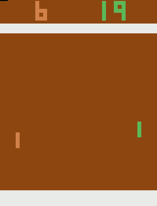
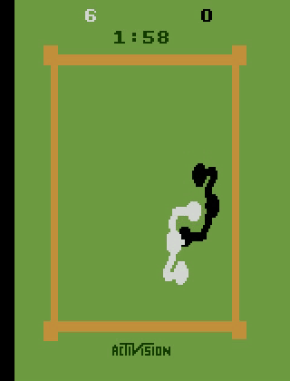
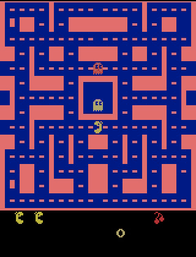
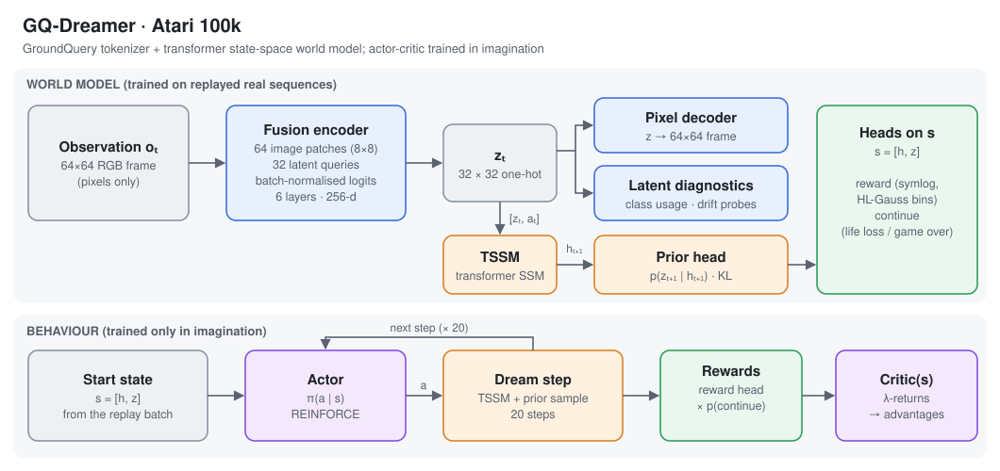
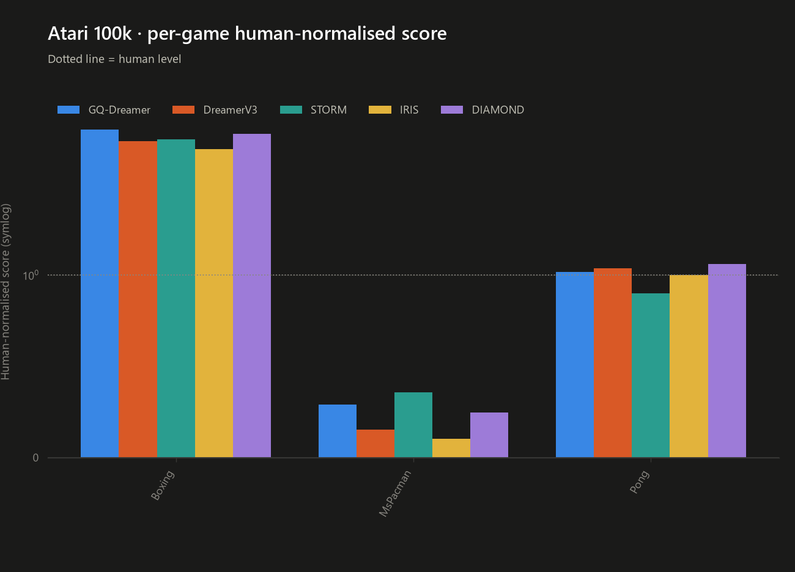

<div align="center">

# GQ-Dreamer · Atari 100k

**A transformer world-model agent benchmarked on Atari 100k: 26 games, 100k agent steps (400k frames, about two hours of play) per game.**

  

*Final agents after 100k environment steps (left to right: Pong, Boxing, Ms. Pac-Man; 2× speed). Sampled actions, no human input.*

</div>

---

> **Status:** work in progress. Training of the 26-game suite is ongoing; the results below cover the games finished
> so far (one seed each). No trained checkpoints are published yet.

## Overview

GQ-Dreamer (**GroundQuery-Dreamer**) is a new world-model agent of the Dreamer family. Its two main components are:

- **GroundQuery tokenizer.** The encoder is a transformer over the 64 patch tokens (8 × 8 pixels) of the 64 × 64 frame.
  **32 learned latent queries** read the patch tokens and output one 32-class categorical each, so the latent `z` is a
  32 × 32 one-hot code. The posterior logits are batch-normalised with a fixed scale (as in BN-VAE), which keeps the
  latent image-dependent and prevents posterior collapse. The pixel decoder reads `z` only.
- **Transformer state-space model (TSSM).** The sequence model is a causal transformer with RoPE, gated attention, an
  attention sink and a KV ring cache. Dreams and acting run as captured CUDA graphs.

The policy is trained with REINFORCE on imagined rollouts of the world model; the critic uses HL-Gauss value targets.

<p align="center"></p>

## Results so far

Score = mean return of 100 evaluation episodes after 100k environment steps.

| Game | Random | Human | **GQ-Dreamer** | DreamerV3 | STORM | IRIS | DIAMOND |
|---|---:|---:|---:|---:|---:|---:|---:|
| Boxing | 0.1 | 12.1 | **92.3** | 78.0 | 80.0 | 70.1 | 86.9 |
| Ms. Pac-Man | 307.3 | 6,951.6 | **2,240.3** | 1,327.0 | 2,673.0 | 999.1 | 1,958.2 |
| Pong | −20.7 | 14.6 | **16.2** | 18.0 | 11.0 | 14.6 | 20.4 |

<p align="center"></p>

Human-normalised score (HNS) = (score − random) / (human − random). The published scores are taken from the papers or
the authors' score files; `gq_dreamer/data/atari100k_baselines.json` lists every source, together with DER, CURL, DrQ,
SPR, SimPLe, TWM, Δ-IRIS, BBF and EfficientZero.

## Protocol

The standard Atari 100k protocol (SimPLe, SPR, IRIS, STORM, DreamerV3, DIAMOND):

- 100k agent steps; frame skip 4 with max-pooling over the last two frames; no sticky actions; 0–30 no-op starts;
  the minimal action set; episodes capped at 108k frames;
- 64 × 64 RGB observations;
- a life loss is a terminal for the world model only, the game itself continues;
- the score is the mean return of **100 evaluation episodes after training**, with actions sampled from the policy.

## Quick start

```bash
git clone <this repository> && cd GQ-Dreamer-Atari100k
conda create -n gqdreamer python=3.11 && conda activate gqdreamer
pip install torch --index-url https://download.pytorch.org/whl/cu124   # CUDA build for training
pip install -r requirements.txt                                        # gymnasium, ale-py (ships the ROMs), opencv, matplotlib
python -m pytest tests -q                                              # CPU smoke tests
```

On Windows, `torch.compile` also needs `pip install -U "triton-windows<3.9"`; without it the model runs eagerly (same
math, slower).

**Notebook.** `main.ipynb` trains a list of games one after the other and writes the comparison report.

**Python.**

```python
from gq_dreamer import run, run_suite, report
run("Pong", seed=0)                                  # 100k env steps + 100 evaluation episodes -> runs/Pong/gq_s0/
run("Pong", seed=0, mode="eval", record=True)        # re-evaluate the newest checkpoint and record videos
run_suite(seeds=(0, 1, 2))                           # all 26 games; finished runs are skipped, interrupted ones resume
report()                                             # results/: per-game table, aggregate HNS and plots
```

**Command line.**

```bash
python -m gq_dreamer train --game Breakout --seed 0
python -m gq_dreamer train --game Breakout --config gq_fast --set eval_every=20000
python -m gq_dreamer suite --games all --seeds 0 1 2
python -m gq_dreamer report
python -m gq_dreamer baselines
```

**Configurations.**

| Config | Description |
|---|---|
| `gq` | the benchmark setting: train ratio 1024, about 99k updates per game |
| `gq_fast` | train ratio 256: a quarter of the updates, for sweeps |
| `gq_small` | a smaller encoder and TSSM: about half the cost per update |
| `gq_debug` | a tiny model for CPU tests |

Any field of `GQDreamerConfig` (`gq_dreamer/config.py`) can be overridden: `run(..., train_ratio=512)` or
`--set train_ratio=512`.

## Outputs

```
runs/<Game>/<config>_s<seed>/   metrics.csv · training.png · checkpoints/ · final_eval.json
results/<config>_per_game.csv   per-game scores next to every published method
results/<config>_*.png          aggregate HNS, per-game HNS, performance profile
```

## Repository layout

```
gq_dreamer/
  model.py          every network: latents, heads, actor / critic, tokenizer, TSSM, prior
  gq_dreamer.py     the agent: world-model update, imagination, streaming collection, evaluation, dream audit
  env.py            ALE environment and vectorised envs
  atari.py          the 26 games and the evaluation protocol
  replay.py         replay buffer (one ring per env) and batch prefetcher
  trainer.py        training loop, evaluation, run(), run_suite()
  benchmark.py      comparison with the published results
  baselines.py      published scores (data/atari100k_baselines.json)
  config.py         GQDreamerConfig and the presets
  audit.py, checkpoint.py, observations.py, plots.py, visualize.py, dream_render.py, train_utils.py
diagnostics/open_loop.py   real vs dreamed frames of a trained run
tests/test_smoke.py        CPU smoke tests
main.ipynb                 training notebook
```

## Related work

GQ-Dreamer is a new model of the Dreamer family of world-model agents, alongside
[DreamerV3](https://arxiv.org/abs/2301.04104) and transformer world models such as
[TWM](https://arxiv.org/abs/2303.07109), [IRIS](https://arxiv.org/abs/2209.00588) and
[STORM](https://arxiv.org/abs/2310.09615): it learns a model of the environment and trains its policy in imagination.
It uses a fixed-scale batch normalisation of the posterior logits as in [BN-VAE](https://arxiv.org/abs/2004.12585),
HL-Gauss value targets ([Farebrother et al., 2024](https://arxiv.org/abs/2403.03950)) and the
[Arcade Learning Environment](https://github.com/Farama-Foundation/Arcade-Learning-Environment).
